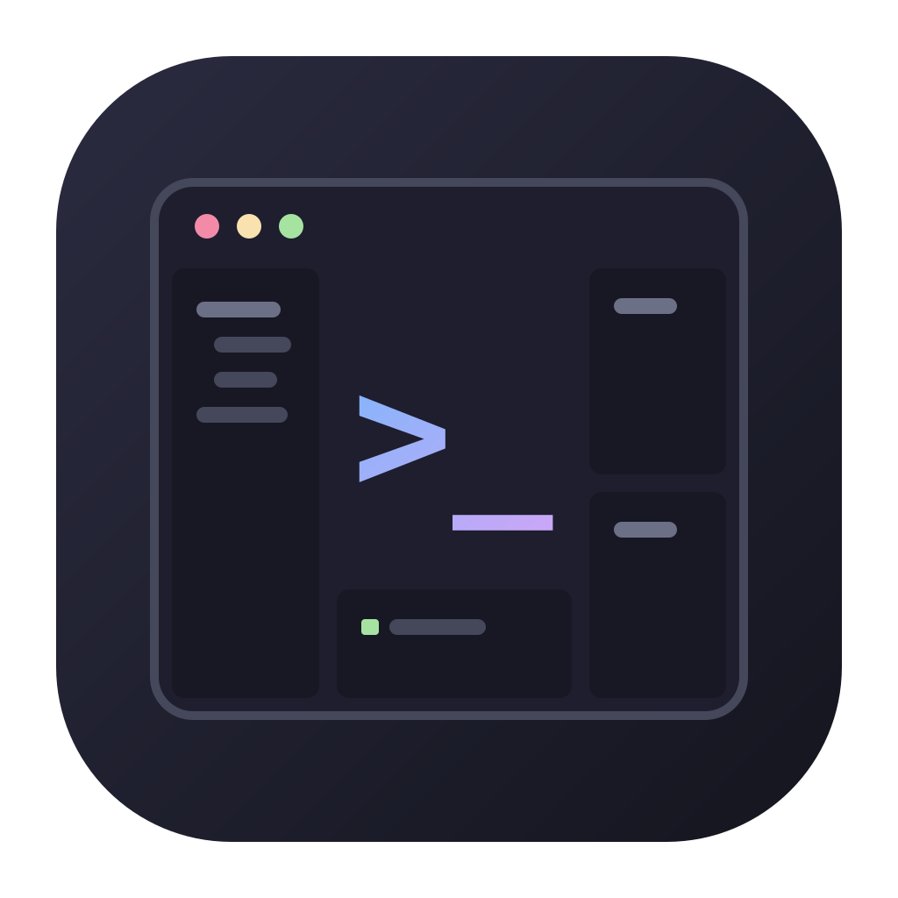

<p align="center">
  
</p>

<h1 align="center">vkTERM</h1>

<p align="center">
Terminal open source para desarrolladores que se maneja como VS Code:<br>
explorador de archivos, editor con pestañas, Shell y agentes de IA
(Claude Code, Codex), todo por teclado.
</p>

<p align="center">
  <a href="https://github.com/vk62001/vkterm/actions/workflows/ci.yml"></a>
  <a href="LICENSE"></a>
  
</p>

**Estado: Fase 1 (H1 + H2) entregada, pendiente de revisión.**

- Ghostty es la terminal gráfica.
- Zellij gestiona paneles y sesiones.
- Micro es el editor.
- El plugin propio `vkterm` (Rust → WebAssembly) aporta el explorador, muestra
  u oculta las zonas, la ventana de atajos (⌘K ⌘S) y el selector de tema
  (⌘K ⌘T). Sin forks.

```
┌──────────┬────────────────────────┬────────────┐
│ DEMO     │ Header.tsx  [App.tsx]  │ Claude Code│
│ ▾ src    │                        │            │
│   ▸ comp │  Editor (Micro)        ├────────────┤
│   App.tsx│                        │ Codex      │
│          ├────────────────────────┤            │
│   ⌘B     │ Shell            ⌘J    │      ⌥⌘B   │
└──────────┴────────────────────────┴────────────┘
```

## Requisitos

- macOS.
- [Zellij](https://zellij.dev) 0.45 y [Micro](https://micro-editor.github.io) 2.0.
- `jq` (incluido en macOS 15+).
- Rust con el target `wasm32-wasip1`, para compilar el plugin:
  `rustup target add wasm32-wasip1`.
- Ghostty, Claude Code y Codex son opcionales.

Para comprobar el entorno:

```sh
scripts/doctor.sh
```

## Uso

Como `code .`: un comando global `vkterm` que abre el proyecto del directorio
actual en una ventana nueva de Ghostty. Se instala con un enlace simbólico en
un directorio del PATH (`~/.local/bin` suele estarlo):

```sh
ln -sfn "$PWD/bin/vkterm-ghostty" ~/.local/bin/vkterm
cd ~/ruta/al/proyecto && vkterm .       # o: vkterm ~/ruta/al/proyecto
```

Desde el repositorio, sin instalar nada:

```sh
# Ventana nueva de Ghostty con el perfil de vkTERM (atajos ⌘ incluidos)
bin/vkterm-ghostty examples/demo

# Sesión limpia sin tocar las existentes
bin/vkterm-ghostty --new examples/demo

# Dentro del terminal actual (cualquier emulador, sin atajos ⌘)
bin/vkterm ~/ruta/al/proyecto [archivo-inicial]
```

- **Plugin.** `bin/vkterm` lo compila automáticamente la primera vez y cuando
  cambian sus fuentes. **La primera vez** (y cuando una versión nueva pide
  permisos nuevos), el explorador pregunta `Allow? (y/n)` por los permisos del
  plugin: haz clic en él y pulsa **y**.
- **Sesiones.** Cada proyecto tiene la suya: si cierras la ventana, la sesión
  sigue viva y el mismo comando la reanuda. Si cambias la configuración de
  Zellij, el siguiente arranque crea una sesión nueva y la anterior queda viva
  (`zellij list-sessions`, `zellij kill-session <nombre>`).
- **Archivo inicial.** Se fija por proyecto con un archivo `.vkterm`
  (`open=src/components/Header.tsx`).
- **Agentes.** Claude Code y Codex quedan en espera: pulsa **Enter** en su
  panel para arrancarlos.
- **Ocultar no cierra nada.** Los procesos siguen vivos y cada panel vuelve a
  su sitio.
- **Foco visible, como en iTerm2.** El panel con el foco se ve normal; los
  demás tienen el fondo más oscuro y el texto apagado. El resaltado de sintaxis
  y los prompts conservan sus colores.
- **Temas, como en VS Code.** ⌘K ⌘T abre el selector: al moverte por la lista
  se prueba cada tema en Ghostty, Zellij, Micro y el atenuado; Enter lo deja,
  Esc vuelve al anterior. Hay nueve: Catppuccin Mocha (predeterminado) y
  Latte, Dark Modern y Light Modern de VS Code, Dracula, Nord, Tokyo Night y
  Gruvbox oscuro y claro.
- **Estado local.** El tema elegido y lo que Micro guarda (cursores, copias,
  historial) viven en `config/local/`, fuera de git.

## Atajos

| Atajo | Acción |
|---|---|
| ⌘B | Mostrar / ocultar el explorador |
| ⌘J | Mostrar / ocultar el Shell |
| ⌥⌘B | Mostrar / ocultar Claude Code y Codex |
| ⌘1 · ⌘2 · ⌘3 · ⌘4 · ⌘5 | Explorador · Editor · Claude Code · Codex · Shell (los muestra si están ocultos) |
| ⌘⌥← · ⌘⌥→ (o ⌃⇧Tab · ⌃Tab) | Pestaña anterior · siguiente del editor |
| ⌘W | Cerrar la pestaña del editor |
| ⌘P | Abrir archivo en una pestaña |
| ⌘S | Guardar |
| ⌘K ⌘S | Ventana con todos los atajos (⌘K y después ⌘S) |
| ⌘K ⌘T | Tema de color |
| ⌘Z · ⌘⇧Z | Deshacer · rehacer (en el editor) |
| ⌘X · ⌘C · ⌘V | Cortar · copiar · pegar (sin selección, la línea entera) |
| ⌘A · ⌘F | Seleccionar todo · buscar (en el editor) |
| ⌘← · ⌘→ | Inicio · fin de línea |
| ⌘⌥↑ · ⌘⌥↓ | Foco al panel de arriba · abajo |
| ⌘K Z | Ampliar o restaurar el panel |
| Ctrl g | Desbloquear Zellij (después p panel, t pestaña, o sesión) |

**En el explorador:**

- ↑ ↓ mueven la selección.
- → despliega una carpeta y ← la pliega.
- **Enter** abre el archivo en una pestaña.
- **Espacio** lo abre sin salir del explorador.
- Una letra salta a la siguiente entrada que empieza por ella.

Los dos ⌥ escriben los caracteres del teclado, como en cualquier app de macOS
(⌥2 = @, ⌥3 = #). Lista completa, limitaciones y conflictos en
[docs/keybindings.md](docs/keybindings.md), o pulsa ⌘K ⌘S.

## Desarrollo

```sh
scripts/build-plugins.sh --test   # compila el plugin y ejecuta sus tests (cargo test)
scripts/smoke-test.py             # configuración + workspace en un PTY
scripts/smoke-test.py --ghostty   # además, Ghostty real con teclas sintetizadas
```

Las pruebas no lanzan los agentes ni tocan las sesiones existentes. La prueba
con teclado físico está en [docs/manual-tests.md](docs/manual-tests.md).

- [Arquitectura](docs/architecture.md)
- [Plan de la Fase 1](docs/phase-1-plan.md) · [Informe de la Fase 1](docs/phase-1-report.md)
- [Próximos pasos: GitHub y plugins](docs/next-steps.md)
- [Informe de la Fase 0](docs/phase-0-report.md)
- [Plugins](plugins/README.md)
- Icono: `docs/assets/vkterm-icon.svg` (fuente), `.png` y `.icns` para un futuro `vkTERM.app`.

Toda la configuración vive en `config/` (y el estado, en `config/local/`): no
se modifican `~/.config/ghostty`, `~/.config/zellij` ni `~/.config/micro`.

## Licencia

Copyright (C) 2026 Eder. vkTERM es software libre bajo la
[GNU General Public License v3.0 o posterior](LICENSE): puedes usarlo,
modificarlo y redistribuirlo, siempre que las versiones modificadas que
distribuyas se publiquen también bajo la GPL. Los componentes de terceros
(MIT y Apache 2.0, compatibles con la GPL) se listan en
[THIRD_PARTY_NOTICES.md](THIRD_PARTY_NOTICES.md).
