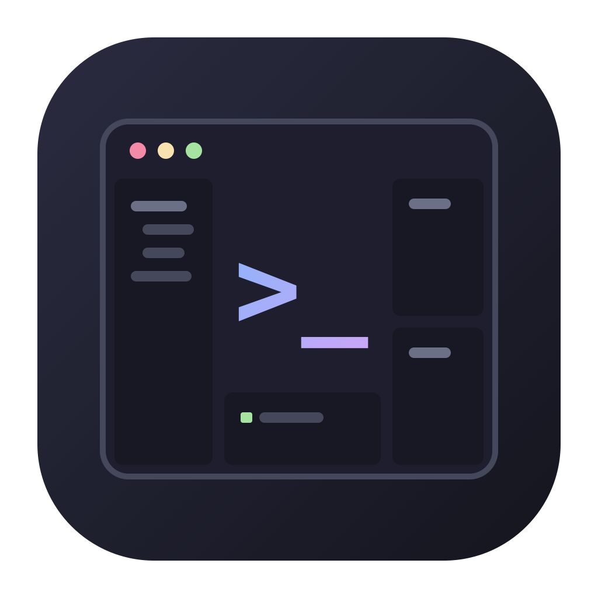

<p align="center">
  
</p>

<h1 align="center">vkTERM</h1>

<p align="center">
Terminal open source para desarrolladores: un terminal normal que, con
<code>vkterm .</code>,<br>convierte la pestaña en un IDE que se maneja como VS Code:
explorador de archivos,<br>editor con pestañas, Shell y agentes de IA
(Claude Code, Codex), todo por teclado.
</p>

<p align="center">
  <a href="https://github.com/vk62001/vkTERM/actions/workflows/ci.yml"></a>
  <a href="LICENSE"></a>
  
  <a href="CHANGELOG.md"></a>
</p>

- **vkTERM.app** es tu terminal de todos los días (una copia local de Ghostty
  con su propio nombre e icono).
- En cualquier pestaña, `vkterm .` (o ⌘B, ⌘J, ⌘P, ⌘⇧P en el prompt) la
  convierte en el IDE de esa carpeta. ⌘K F la devuelve al terminal, con el
  shell de antes intacto.
- Ghostty es la terminal gráfica.
- Zellij gestiona paneles y sesiones.
- Micro es el editor.
- El plugin propio `vkterm` (Rust → WebAssembly) aporta el explorador (con
  los colores de git), la vista Control de código fuente (⌃⇧G), muestra
  u oculta las zonas, la barra de estado, la memoria de cada carpeta, la
  ventana de atajos (⌘K ⌘S) y los selectores de tema (⌘K ⌘T) y de fuente
  (⌘K ⌘L). Sin forks.

## Requisitos

- macOS.
- [Zellij](https://zellij.dev) 0.45 y [Micro](https://micro-editor.github.io) 2.0.
- `jq` (incluido en macOS 15+).
- Rust con el target `wasm32-wasip1`, para compilar el plugin:
  `rustup target add wasm32-wasip1`.
- Ghostty 1.3 o posterior y las Xcode Command Line Tools (clang), para crear
  vkTERM.app. Claude Code y Codex son opcionales.
- Opcional: Xcode 26 con su Metal Toolchain, para compilar Ghostty sin el
  indicador «⌨ vkterm» ([abajo](#ghostty-sin-el-indicador)).

Para comprobar el entorno:

```sh
scripts/doctor.sh
```

### Lenguajes (LSP)

Sugerencias, errores en línea, ir a la definición, información y formato en el
editor, como en VS Code. Es opcional y se instala con un comando, con versiones
fijas y todo dentro de `config/local/`:

```sh
bin/vkterm-plugins install          # TypeScript/JavaScript, Python, Rust y Swift
bin/vkterm-plugins install go       # Go (descarga Go: unos 450 MB)
bin/vkterm-plugins status
```

Usa el plugin [µlsp](https://github.com/Andriamanitra/mlsp) de Micro.
Necesita node ≥ 22.22.2 para TypeScript y Python, y Xcode para Swift. En Rust
añade el componente `rust-analyzer` de rustup.

## Instalación

```sh
bin/vkterm-app install --link
```

- Crea `~/Applications/vkTERM.app`: una copia de tu Ghostty.app con otro
  nombre, icono e identificador, firmada en local. Abre el perfil de vkTERM y
  no lee `~/.config/ghostty`. Tu Ghostty sigue igual. Puedes moverla a
  `/Applications`: `install` la actualiza donde esté.
- `--link` crea el comando `vkterm` en `~/.local/bin`.
- **Cada vez que actualices Ghostty**, vuelve a ejecutar
  `bin/vkterm-app install`. `scripts/doctor.sh` avisa si la app se quedó
  atrás. macOS puede volver a pedir los permisos de vkTERM (por ejemplo, para
  leer un disco externo).
- No uses «Check for Updates…» dentro de vkTERM: actualiza Ghostty y repite
  `install`.

### Ghostty sin el indicador

Ghostty 1.3 dibuja un botón «⌨ vkterm» flotando sobre el terminal mientras
una pestaña es el IDE, y no tiene opción para ocultarlo ni moverlo. vkTERM
compila Ghostty con un parche que lo quita (`patches/ghostty`); el modo IDE se
ve en la barra de estado.

```sh
scripts/build-ghostty.sh        # la versión de tu Ghostty.app, unos minutos
bin/vkterm-app install          # con vkTERM.app cerrada (⌘Q)
```

Necesita Xcode 26 con su Metal Toolchain
(`xcodebuild -downloadComponent MetalToolchain`) y red: descarga Zig, el código
de Ghostty y sus dependencias en `~/Library/Caches/vkterm`. `install` usa esa
compilación si existe para la versión de tu Ghostty.app; si no, copia
Ghostty.app tal cual. **Cada vez que actualices Ghostty**, repite los dos
comandos.

### DMG

```sh
scripts/build-dmg.sh
```

Empaqueta la vkTERM.app instalada en `dist/vkTERM-<versión>.dmg`, con el
acceso a Aplicaciones para arrastrarla. La app no lleva vkTERM dentro: solo
sirve en un Mac con el repositorio en la misma ruta que en este (el lanzador lo
busca allí) y con los [requisitos](#requisitos) instalados. La firma es local:
si el DMG llega descargado o por AirDrop, macOS no abre la app hasta quitarle
la cuarentena (`xattr -dr com.apple.quarantine /Applications/vkTERM.app`).

## Uso

Abre **vkTERM** (Dock, Spotlight o la carpeta Aplicaciones): es un terminal normal, con
tu shell, pestañas (⌘T) y divisiones (⌘D) de Ghostty. Cuando quieras trabajar
en un proyecto:

```sh
cd ~/ruta/al/proyecto && vkterm .     # como `code .`
```

La pestaña pasa a ser el IDE:

```
┌──────────┬────────────────────────┬────────────┐
│ DEMO     │ Header.tsx  [App.tsx]  │ Claude Code│
│ ▾ src    │                        │            │
│   ▸ comp │  Editor (Micro)        ├────────────┤
│   App.tsx│                        │ Codex      │
│          ├────────────────────────┤            │
│   ⌘B     │ Shell            ⌘J    │      ⌥⌘B   │
├──────────┴────────────────────────┴────────────┤
│ ⌨ vkTERM  demo  ⎇ main     ⌘K F cerrar carpeta │
└────────────────────────────────────────────────┘
```

- **Atajos que convierten.** En el prompt, ⌘B, ⌘J, ⌘P y ⌘⇧P convierten la
  pestaña con la carpeta actual y después hacen lo suyo (⌘P abre la búsqueda
  de archivos). Lo que estabas escribiendo vuelve al prompt al salir.
- **Proyectos recientes: ⌘O** («Abrir reciente», como en VS Code), en el
  prompt o en el IDE: la lista de las carpetas que ya abriste, la última
  primero; escribe para filtrar. Enter la abre en esta pestaña (desde el IDE,
  cierra antes la carpeta actual) y ⇧Enter en una ventana nueva. En el
  terminal también vale `vkterm -r`.
- **Volver al terminal: ⌘K F** («Cerrar carpeta», como en VS Code). Cierra
  Micro, Claude Code y Codex y vuelves al shell de antes, con su scroll e
  historial. Solo pregunta si se perdería algo (archivos sin guardar o un
  agente en marcha): Guardar y cerrar · Cerrar sin guardar · Cancelar.
- **Memoria, como VS Code.** Cerrar la carpeta o la ventana termina la sesión,
  pero vkTERM recuerda las pestañas del editor, qué zonas se ven, el foco y
  las carpetas desplegadas del explorador. El siguiente `vkterm .` lo deja
  igual. Los agentes empiezan de cero.
- **Cada pestaña es independiente.** Una puede ser el IDE de un proyecto y
  otra un terminal normal. Desde el IDE, ⌘T abre una pestaña en modo terminal.
- **Traer el IDE a otra ventana.** `vkterm .` en otra pestaña o ventana de
  vkTERM (por ejemplo, una ventana a pantalla completa) trae el IDE de esa
  carpeta si ya estaba abierto en otra, con todo vivo: Claude Code, Codex, el
  Shell y los archivos sin guardar. La pestaña de antes vuelve a su shell y
  lo dice. `vkterm` sin nada es `vkterm .`.
- **Desde otro terminal** (iTerm) o desde el Shell del propio IDE,
  `vkterm RUTA` abre una ventana de vkTERM ya convertida. Si esa carpeta ya
  está abierta, va a su pestaña (y lo dice): como en VS Code, cada carpeta se
  abre una sola vez. Para tener varios IDE, uno por carpeta.
- **Archivo inicial.** `vkterm . src/App.tsx`, o la línea `open=` del archivo
  `.vkterm` del proyecto (solo la primera vez, sin memoria).
- **Indicador del modo.** Mientras una pestaña es el IDE, la barra de estado
  empieza por «⌨ vkTERM», como el distintivo de la izquierda de VS Code. Con
  Ghostty sin compilar ([arriba](#ghostty-sin-el-indicador)), Ghostty dibuja
  además su botón «⌨ vkterm» encima de la barra.
- **Plugin.** `vkterm` lo compila automáticamente la primera vez y cuando
  cambian sus fuentes. **La primera vez** (y cuando una versión nueva pide
  permisos nuevos), el explorador pregunta `Allow? (y/n)` por los permisos del
  plugin: haz clic en él y pulsa **y**.
- **Agentes.** Claude Code y Codex quedan en espera: pulsa **Enter** en su
  panel para arrancarlos.
- **Ocultar no cierra nada.** Los procesos siguen vivos y cada panel vuelve a
  su sitio.
- **Foco visible, como en iTerm2.** El panel con el foco se ve normal; los
  demás tienen el fondo más oscuro y el texto apagado. El resaltado de sintaxis
  y los prompts conservan sus colores.
- **Temas de VS Code, con sus colores.** ⌘K ⌘T abre el selector, agrupado
  como el de VS Code (claros, oscuros y alto contraste); escribe para filtrar.
  Al moverte por la lista se prueba cada tema; Enter lo deja, Esc vuelve al
  anterior. Hay 24:
  - de serie en VS Code: Dark Modern, Light Modern, Dark+, Light+, Dark y
    Light High Contrast, Monokai, Solarized Dark y Light, Abyss, Quiet Light,
    Kimbie Dark y Tomorrow Night Blue;
  - del Marketplace: Catppuccin Mocha (predeterminado) y Latte, Dracula,
    Nord, Tokyo Night, Gruvbox oscuro y claro, Monokai Pro (aproximación: es
    de pago), SynthWave '84, Shades of Purple y Cobalt2.

  Cada tema pone sus colores en la paleta del terminal, en el resaltado del
  editor (color de 24 bits: palabras clave, cadenas, comentarios, tipos…) y
  en la interfaz: barra lateral, selección, paleta, barra de estado (azul en
  Dark+) y borde del panel con el foco. Los valores son los del tema; qué
  palabra recibe cada color depende de las reglas de sintaxis de Micro, más
  sencillas que las de VS Code, así que el resaltado se parece mucho pero no
  es idéntico.
- **Fuente, con prueba en vivo.** ⌘K ⌘L abre el selector con las fuentes
  monoespaciadas instaladas: al moverte se prueba cada una y ← → cambian el
  tamaño. ⌘+, ⌘- y ⌘0 cambian el tamaño en todas las ventanas y se recuerda
  (en el modo terminal, desde el prompt).
- **Brackets, como en VS Code.** Al escribir ( [ { o comillas se añade el
  cierre; con texto seleccionado, lo envuelven. La pareja del bracket del
  cursor se resalta y hay guías de sangría en cada nivel. Los colores por
  nivel de los brackets no: Micro no lo permite sin modificarlo.
- **Estado local.** El tema y la fuente elegidos, la memoria de cada carpeta
  y lo que Micro guarda (cursores, copias, historial) viven en
  `config/local/`, fuera de git. Otros ajustes de Ghostty pueden ir en
  `config/local/user.ghostty`.

Sin vkTERM.app, en cualquier otro terminal: `vkterm --here ~/ruta/al/proyecto`
abre el IDE en ese terminal (sin los atajos ⌘ ni el modo terminal).

## Atajos

En el **modo terminal**, los de Ghostty, salvo ⌘B, ⌘J, ⌘P y ⌘⇧P, que
convierten la pestaña. ⌘V con una imagen en el portapapeles la adjunta en
Claude Code y Codex, como en el IDE. En el **modo IDE**:

| Atajo | Acción |
|---|---|
| ⌘K F | Cerrar la carpeta y volver al terminal |
| ⌘T · ⌘⇧N | Pestaña · ventana nueva en modo terminal |
| ⌘B | Mostrar / ocultar la barra lateral (explorador o Control de código fuente) |
| ⌃⇧G · ⌘⇧E | Control de código fuente (cambios de git y conflictos) · volver al explorador |
| ⌘Enter | Commit, en Control de código fuente (la pantalla completa queda en ⌃⌘F) |
| ⌘J | Mostrar / ocultar el Shell |
| ⌥⌘B | Mostrar / ocultar Claude Code y Codex |
| ⌘1 · ⌘2 · ⌘3 · ⌘4 · ⌘5 | Explorador · Editor · Claude Code · Codex · Shell (los muestra si están ocultos) |
| ⌘⌥← · ⌘⌥→ (o ⌃⇧Tab · ⌃Tab) | Pestaña anterior · siguiente del editor |
| ⌘W | Cerrar la pestaña del editor |
| ⌘N | Nuevo archivo: pide el nombre y lo crea en la carpeta seleccionada del explorador |
| ⌘P | Abrir archivo por nombre (búsqueda difusa, como VS Code) |
| ⌘⇧P | Paleta de comandos |
| ⌘S | Guardar |
| ⌘K ⌘S | Ventana con todos los atajos (⌘K y después ⌘S) |
| ⌘K ⌘T | Tema de color |
| ⌘K ⌘L | Fuente (tipo y tamaño) |
| ⌘+ · ⌘- · ⌘0 | Tamaño de letra: más, menos, el normal (se recuerda) |
| ⌘Z · ⌘⇧Z | Deshacer · rehacer (en el editor) |
| ⌘X · ⌘C · ⌘V | Cortar · copiar · pegar (sin selección, la línea entera) |
| ⌘A · ⌘F | Seleccionar todo · buscar (en el editor) |
| ⌘← · ⌘→ | Inicio · fin de línea |
| ⌘⌥↑ · ⌘⌥↓ | Foco al panel de arriba · abajo |
| ⌘K Z | Ampliar o restaurar el panel |
| Ctrl g | Desbloquear Zellij (después p panel, t pestaña, o sesión) |

**Clic derecho en el editor:** un menú como el de VS Code, junto al puntero,
con Cortar, Copiar, Pegar, Seleccionar todo y Paleta de comandos…

**En el explorador:**

- ↑ ↓ mueven la selección.
- → despliega una carpeta y ← la pliega.
- **Enter** abre el archivo en una pestaña.
- **Espacio** lo abre sin salir del explorador.
- Una letra salta a la siguiente entrada que empieza por ella.
- Los archivos con cambios de git van en su color, con la letra a la derecha
  como en VS Code: M modificado, U nuevo, A añadido, ! conflicto; las
  carpetas con cambios dentro llevan •, y lo ignorado sale apagado.

**En Control de código fuente (⌃⇧G)**, como la vista de VS Code:

- Arriba, la rama con los commits por bajar y por subir, y el mensaje del
  commit: escribe y pulsa Enter o ⌘Enter. Sin nada preparado, pregunta si
  preparar todo.
- Debajo, la comparación con `main`: si fusionarla daría conflictos y en qué
  archivos («CONFLICTOS CON main»), sin tocar nada (`git merge-tree`). Enter
  en esa línea elige otra rama. La barra de estado también lo avisa.
- Los grupos «Conflictos de fusión» (durante un merge o rebase), «Cambios
  preparados» y «Cambios». **Espacio** prepara o quita, **Enter** muestra las
  diferencias en una ventana flotante (q la cierra), **→** abre el archivo y
  **⌫** descarta sus cambios (pregunta antes). En la cabecera de un grupo,
  Espacio prepara o quita todo.
- Pull, Push, Sincronizar, Fetch y Abortar la fusión están en ⌘⇧P («Git: …»).

Los dos ⌥ escriben los caracteres del teclado, como en cualquier app de macOS
(⌥2 = @, ⌥3 = #). Lista completa, limitaciones y conflictos en
[docs/keybindings.md](docs/keybindings.md), o pulsa ⌘K ⌘S.

## Desarrollo

```sh
scripts/build-plugins.sh --test   # compila el plugin y ejecuta sus tests (cargo test)
scripts/gen-themes.py             # genera los temas (Ghostty, Micro, Zellij, plugin) desde los de VS Code
python3 -m unittest scripts/test_gen_themes.py
python3 -m unittest scripts/test_vkterm_git.py   # bin/vkterm-git (Control de código fuente)
scripts/smoke-test.py             # configuración + workspace en un PTY
scripts/smoke-test.py --ghostty   # además, vkTERM Test.app real con teclas sintetizadas
scripts/lsp-check.py              # LSP en sesiones reales, por lenguaje (varios minutos)
```

Las pruebas no lanzan los agentes ni tocan las sesiones existentes. Con
`--ghostty` crean (si hace falta) `vkTERM Test.app` en `~/Library/Caches/vkterm`,
con otro identificador que la app de uso diario. La prueba con teclado físico
está en [docs/manual-tests.md](docs/manual-tests.md).

- [Cambios por versión](CHANGELOG.md) (la versión actual: `vkterm --version`)
- [Arquitectura](docs/architecture.md)
- [Plan de la Fase 1](docs/phase-1-plan.md) · [Informe de la Fase 1](docs/phase-1-report.md)
- [Plan de la Fase 2](docs/phase-2-plan.md) · [Informe de la Fase 2](docs/phase-2-report.md)
- [Próximos pasos: GitHub y plugins](docs/next-steps.md)
- [Informe de la Fase 0](docs/phase-0-report.md)
- [Plugins](plugins/README.md)
- Icono: `docs/assets/vkterm-icon.png` (1024 px), `vkterm-icon-256.png` y `vkterm.icns` (el de vkTERM.app).

Toda la configuración vive en `config/` (y el estado, en `config/local/`): no
se modifican `~/.config/ghostty`, `~/.config/zellij` ni `~/.config/micro`.

## Licencia

Copyright (C) 2026 Eder. vkTERM es software libre bajo la
[GNU General Public License v3.0 o posterior](LICENSE): puedes usarlo,
modificarlo y redistribuirlo, siempre que las versiones modificadas que
distribuyas se publiquen también bajo la GPL. Los componentes de terceros
(MIT y Apache 2.0, compatibles con la GPL) se listan en
[THIRD_PARTY_NOTICES.md](THIRD_PARTY_NOTICES.md).
